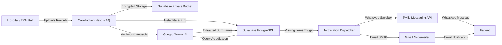

# Care.locker 🏥🔐
### Patient Document Management & Automated Insurance Query Resolution

**Care.locker** is an enterprise-grade healthcare operations platform built for hospital billing departments, TPA desk coordinators, and insurance operations teams. It consolidates patient medical records into a secure private vault, uses Google Gemini multimodal AI to analyze medical records and insurer query letters, forensically matches requirements against uploaded evidence, and automatically dispatches patient document requests across WhatsApp and Email.

---

## 📑 Table of Contents
1. [Key Features](#-key-features)
2. [Technology Stack](#-technology-stack)
3. [Architecture Overview](#-architecture-overview)
4. [Project Structure](#-project-structure)
5. [Local Development Setup](#-local-development-setup)
6. [Environment Variables](#-environment-variables)
7. [Database Migrations](#-database-migrations)
8. [Testing & Verification](#-testing--verification)
9. [Deploying to Vercel](#-deploying-to-vercel)

---

## 🚀 Key Features

### 1. 🗄️ Secure Document Vault & Patient Directory
- **Role-Based Access**: Multi-tenant authorization for `Admin` and `Agent` roles with Next.js edge middleware.
- **Private Supabase Storage**: Uploads (PDF, PNG, JPG) stored in a private bucket (`patient-documents`) served via short-lived signed URLs (5-minute expiry).
- **Document Categories**: 9 structured medical categories (Discharge Summaries, Itemized Bills, Pharmacy Bills, Lab Reports, Diagnostic Imaging, OT Notes, Prescriptions, Pre-auth Approvals, Other).
- **Document Deletion & Evidence Invalidation**: Safe document deletion with explicit confirmation. Automatically cleans up storage and marks affected query matching points as `needs_review` to prevent stale adjudication results.

### 2. 🧠 Multimodal Clinical AI (Google Gemini)
- **Document Understanding**: Automatically processes clinical and billing records to extract hospital names, dates, financial summaries, diagnoses, procedures, and insurance relevancy.
- **Query Requirement Extraction**: Ingests insurer query letters (Star Health, Medi Assist, Care Health, HDFC ERGO, etc.) and extracts verbatim bullet points into structured requirements.
- **Forensic Document Matching**: Adjudicates each query point against vault documents with verifiable evidence quotes and confidence scoring. Differentiates between `available`, genuinely `missing`, and `needs_review`.

### 3. 📲 Automated Multi-Channel Dispatch (WhatsApp & Email)
- **Automatic Notification Engine**: Generates empathetic, plain-language patient notifications requesting *only* genuinely missing documents (excluding available and unverified items).
- **Twilio WhatsApp Integration**: Formatted dispatch via WhatsApp Sandbox with strict 15-second timeouts, provider SID recording, and robust error handling (21654 / 63015).
- **Nodemailer Gmail SMTP**: Direct, reliable email delivery to patient addresses.
- **Channel Independence & Idempotency**: Failures on WhatsApp never block email dispatch and vice versa. Full delivery history and provider responses recorded in PostgreSQL.

### 4. 🎨 Modern Minimalist Interface
- High-contrast, clean theme (`#111111` deep darks, `#7956B5` brand purple, `#F2EEFA` soft surfaces, `#E7E3EF` borders) with zero noisy gradients.

---

## 🛠️ Technology Stack

- **Frontend**: [Next.js 14](https://nextjs.org/) (App Router, Server Components & Route Handlers), React 18, TypeScript (Strict Mode)
- **Styling**: Tailwind CSS, Lucide React Icons
- **Database & Auth**: [Supabase](https://supabase.com/) (PostgreSQL 15, Row Level Security, Supabase Auth via `@supabase/ssr`, Private Storage)
- **AI Engine**: Google Gemini API (`gemini-3.5-flash` / `@google/genai`)
- **Messaging**:
  - WhatsApp: Twilio Node SDK (`twilio`)
  - Email: Nodemailer with Gmail SMTP
- **Validation**: Zod schema validation
- **Testing**: Jest, TypeScript compiler (`tsc --noEmit`)

---

## 🏗️ Architecture Overview



---

## 📁 Project Structure

```text
carelocker/
├── scripts/
│   ├── seed.mjs                       # Database seeder
│   ├── test-stage2.ts                 # Gemini AI pipeline verification suite
│   ├── test-stage3.ts                 # Multi-channel delivery tests
│   └── test-document-deletion.ts      # Deletion & evidence safety test
├── src/
│   ├── app/
│   │   ├── (auth)/login/              # Staff authentication
│   │   ├── (dashboard)/
│   │   │   ├── dashboard/             # Overview metrics & claim status
│   │   │   ├── patients/              # Patient directory & detail vaults
│   │   │   └── settings/              # System & staff configuration
│   │   └── api/                       # Secure server endpoints (documents, queries, messages)
│   ├── components/
│   │   ├── common/                    # Modal, Badge, Button components
│   │   ├── documents/                 # Document list, uploader & summary modal
│   │   ├── layout/                    # Header and Care.locker Sidebar
│   │   ├── patients/                  # Patient cards & forms
│   │   └── queries/                   # Query letter processing & match UI
│   ├── lib/
│   │   ├── gemini/                    # Gemini client, schemas & prompt pipeline
│   │   ├── messaging/                 # Twilio, Nodemailer & dispatcher engine
│   │   └── supabase/                  # Browser, server & admin clients
│   └── types/
│       └── database.ts                # TypeScript Supabase database definitions
├── supabase/
│   └── migrations/                    # SQL schemas, RLS policies, audit logs
├── .env.example                       # Reference environment variables
└── README.md
```

---

## 💻 Local Development Setup

### 1. Prerequisites
- [Node.js](https://nodejs.org/) v18 or later (v20+ recommended)
- A [Supabase](https://supabase.com) project
- A [Google AI Studio](https://aistudio.google.com/) API Key
- (Optional for messaging) Twilio Account & Gmail App Password

### 2. Installation
```bash
# Clone the repository
git clone https://github.com/Chaplot05/CareLocker.git
cd CareLocker

# Install dependencies
npm install
```

### 3. Configure Environment Variables
Copy `.env.example` to `.env.local` and add your credentials:
```bash
cp .env.example .env.local
```

### 4. Database Schema Setup
Execute the SQL migration files located in `supabase/migrations/` sequentially in your Supabase SQL Editor:
1. `20261104000000_stage1_foundation.sql` (Tables: `profiles`, `patients`, `documents`, `audit_logs`, storage bucket)
2. `20261104000001_stage2_query_automation.sql` (Tables: `query_letters`, `query_points`, `document_matches`)
3. `20261104000002_stage3_messaging.sql` (Table: `messages` & indexes)
4. `20261104000003_documents_update_policy.sql` (RLS policies for document updates)

### 5. Start the Development Server
```bash
npm run dev
```
Open [http://localhost:3000](http://localhost:3000) in your browser.

---

## 🔑 Environment Variables

| Variable | Description | Exposure |
| :--- | :--- | :--- |
| `NEXT_PUBLIC_SUPABASE_URL` | Supabase Project URL | Public / Client |
| `NEXT_PUBLIC_SUPABASE_ANON_KEY` | Supabase Anon Key | Public / Client |
| `SUPABASE_SERVICE_ROLE_KEY` | Supabase Admin Key | Server-only |
| `NEXT_PUBLIC_SITE_URL` | Canonical Site URL (`http://localhost:3000`) | Public / Client |
| `GEMINI_API_KEY` | Google Gemini API Key | Server-only |
| `GEMINI_MODEL` | Gemini Model (e.g., `gemini-3.5-flash`) | Server-only |
| `TWILIO_ACCOUNT_SID` | Twilio Account SID | Server-only |
| `TWILIO_AUTH_TOKEN` | Twilio Auth Token | Server-only |
| `TWILIO_WHATSAPP_NUMBER` | Twilio WhatsApp Sender Number | Server-only |
| `SMTP_HOST` | SMTP Server (e.g., `smtp.gmail.com`) | Server-only |
| `SMTP_PORT` | SMTP Port (`587`) | Server-only |
| `SMTP_USER` | SMTP Username / Gmail address | Server-only |
| `SMTP_PASS` | Gmail App Password | Server-only |
| `SMTP_FROM_EMAIL` | Sender Email Address | Server-only |

---

## 🧪 Testing & Verification

Run the test suite and type checker:

```bash
# Run unit tests
npm test

# Type-check TypeScript without emitting output
npx tsc --noEmit

# Test production build
npm run build
```

---

## 🌐 Deploying to Vercel

1. Push your code to GitHub:
   ```bash
   git add .
   git commit -m "feat: complete Care.locker platform"
   git push origin master
   ```
2. Import the project into [Vercel](https://vercel.com/new).
3. In **Project Settings** → **Environment Variables**, add the environment variables defined in `.env.example`.
4. Deploy! Next.js App Router will automatically compile serverless endpoints and edge middleware.

---

## 🛡️ License
Private & Proprietary — Developed for healthcare operations.
